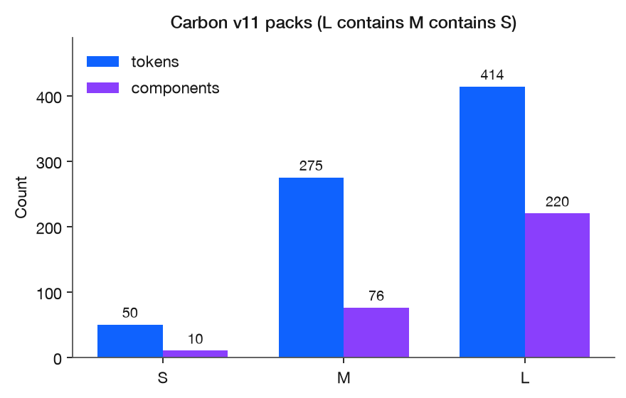
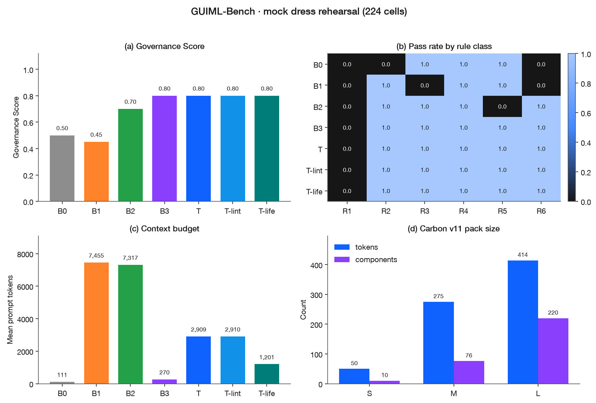
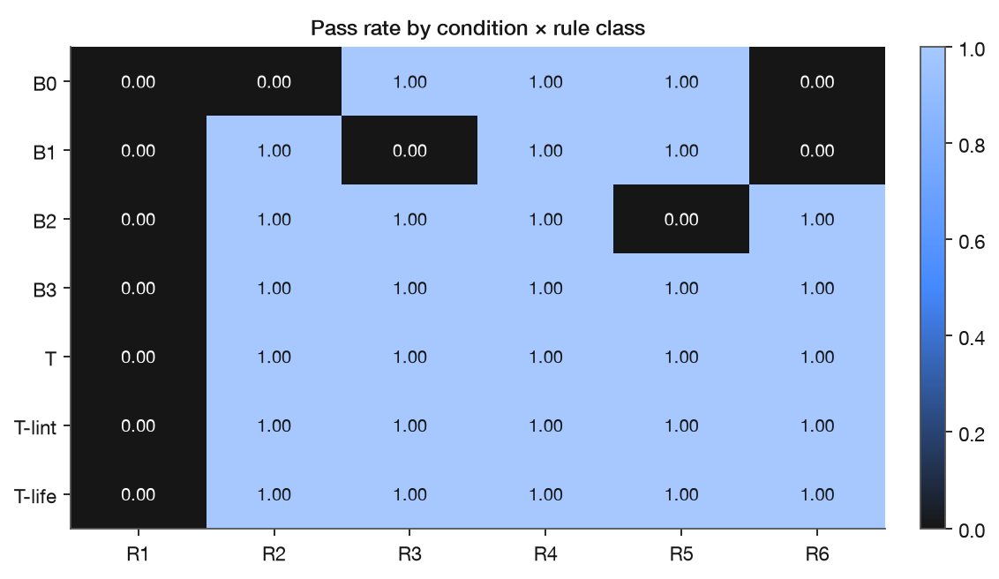

# GUIML

**GUIML** (Graphical User Interface Markup Language) is a machine-readable way to give an AI coding agent a design system — not as a long markdown file, and not as a pile of screenshots, but as a graph of rules.

This repository contains two things:

1. **GUIML** — the representation and pipeline (retrieve → emit → lint → compile).
2. **GUIML-Bench** — a public benchmark that asks whether that pipeline (and the usual alternatives) actually obey the system.

---

## The problem

A design system (IBM Carbon, Material, your company's library) is a set of **hard rules**:

- colors and spacing are named tokens, not hex codes
- you compose real components (`Modal` has a header, body, and footer)
- “danger” is for irreversible actions, not for decoration
- last year’s token names are retired; this year’s names replace them
- the layout has to hold together at 375px as well as 1440px
- the result has to be accessible

LLMs do not treat those as rules. They treat design as a **vibe**: they have seen a lot of buttons, so they emit something that looks like a button. That is why vibe-coded UIs look plausible and still ship the wrong color, a deprecated component, or a modal where a toast belongs.

Dumping `design.md` into the prompt does not fix this. The file is too long, the model drifts, and there is no way to *check* the output against the system. Component registries help with “use `Button`, not a `<div>`” — they do not encode *when* danger is allowed, or that `$interactive-01` was renamed.

GUIML is the missing object: the design system, written so an agent can retrieve the relevant slice, emit a structured UI, and get caught when it breaks a rule.

---

## What GUIML is

GUIML is JSON. There are two kinds of document.

### 1. A **system** graph (the design system itself)

Nodes are tokens, components, patterns, and usage rules. Every node is tagged with:

- a **rule class** (what kind of constraint it is — see below)
- a **status** (`active`, `deprecated`, `renamed`, `split`)

Edges say how those nodes relate:

| Edge | Meaning |
| --- | --- |
| `dependsOn` | composition: `Modal` requires `ModalHeader` |
| `ref` | this style value is this token |
| `replaces` | lifecycle: v10 `$ui-background` → v11 `$background` |
| `constrains` | usage: danger only for irreversible actions |

The IBM Carbon v11 system graphs in this repo live at `guiml/carbon-{s,m,l}.guiml.json`.

### 2. An **instance** (one generated screen)

This is what the model is asked to emit for a task: a component tree. Every component name must exist in the catalog. Every color/spacing value must be a token `ref`, not `#0f62fe`.

A compiler then turns that instance into `@carbon/react` TypeScript.

### Pipeline

```
user prompt
    │
    ▼
retrieve a small sub-graph
(only the rules this task needs, budgeted per rule class
 so a 3,000-token system does not fill the context window)
    │
    ▼
model emits a GUIML instance (JSON)
    │
    ▼
linter  ── schema, token refs, composition, deprecations
    │         renamed tokens are auto-rewritten via `replaces`
    │         at most 2 repair loops
    ▼
compiler  →  production @carbon/react TSX
```

That is the whole trick. The model never has to “remember” the design system. It is handed the relevant slice, forced to speak in catalog names, and blocked from emitting retired ones.

---

## Rule classes

A design system is not one checklist. GUIML (and the benchmark) split it into six classes so you can see *which* rules an agent fails.

| | Class | In human terms | Example failure |
| --- | --- | --- | --- |
| R1 | Lexical / token | Use the named color, and the *right* named color | helper text in `$text-primary`, or `#525252` |
| R2 | Structural / API | Real components, real props, legal composition | `<Tag variant="ghost">`, or a Modal with no footer |
| R3 | Semantic / usage | The right component *for the intent* | a Button for status; a Modal for “saved” |
| R4 | Accessibility | WCAG 2.1 AA on the rendered page | icon-only button with no name |
| R5 | Lifecycle | Do not use last year’s names | `$interactive-01` after the v11 rename |
| R6 | Layout | Grid + it still works at 375px | absolute positioning, horizontal overflow |

R1, R2, and R5 can be linted. R3 cannot — “danger is for irreversible actions” is a design judgment — so the benchmark grades it with a separate judge model. R4 and R6 are checked on a real render (Playwright + axe-core).

Full definitions: [`docs/taxonomy.md`](docs/taxonomy.md). Schema: [`guiml/schema.json`](guiml/schema.json).

---

## Current milestone

The repository currently provides the experiment core:

- Carbon v11 extract (tokens, `@carbon/react` catalog, v10→v11 lifecycle) at three nested scales
- 80 intent-level tasks (20 traps) and 15 gold `@carbon/react` screens
- conditions B0–B3 (none / prose / JSON dump / registry tools) and treatment T (GUIML)
- deterministic graders for R1, R2, R5; static + Playwright/axe graders for R4, R6; LLM-judge protocol for R3
- mock, Mistral, OpenAI, Anthropic, and Hugging Face Inference providers
- a 224-cell mock dress rehearsal that exercises retrieve → emit → grade → figures

The mock run is a pipeline smoke test, not research evidence. It confirms that extraction, grading, and reporting work before paid API calls. The real-model matrix is documented in [`RUN.md`](RUN.md) and has not been executed yet.

---

## Carbon v11 extract

Pinned at `@carbon/themes` 11.84 and `@carbon/react` 1.119. Packs satisfy **L contains M contains S**.



| Scale | Tokens | Components | GUIML nodes | GUIML edges |
| --- | ---: | ---: | ---: | ---: |
| S | 50 | 10 | 167 | 143 |
| M | 275 | 76 | 428 | 169 |
| L | 414 | 220 | 710 | 169 |

The lifecycle table, parsed from Carbon’s own v11 migration doc, has **145 token rows**, **91 component rows**, **90 forbidden v10 names**, and **12 removed components**. Those `replaces` edges are what let the linter rewrite last year’s names instead of hoping the model forgot them.

---

## Mock dress rehearsal

The first end-to-end run used the `demo` profile: 8 tasks × 7 conditions × {S, L} × 2 reps = **224 cells** on the deterministic `mock` provider. The mock emits a fixed TSX fixture per condition so the stats pipeline has a signal before any paid model is called.



| Metric | B0 none | B1 prose | B2 dump | B3 registry | T GUIML |
| --- | ---: | ---: | ---: | ---: | ---: |
| Governance Score | 0.50 | 0.45 | 0.70 | 0.80 | 0.80 |
| Mean prompt tokens | 111 | 7,455 | 7,317 | 270 | 2,909 |



On this harness check, dumping the system (B1/B2) costs ~7k prompt tokens; GUIML retrieval sits at ~2.9k; the registry condition is cheapest at ~270 because it only pays for tool calls. B0 fails structure and layout (R2/R6). B1 fails usage and layout (R3/R6). B2 fails lifecycle (R5) — the dump fixture still speaks v10 token names. R1 is 0.00 in every mock fixture: none of the stubs emit the task’s expected tokens, which is a property of the mock, not of the models.

This run does **not** establish that GUIML outperforms a registry on real models. The mock is condition-tagged on purpose so the heatmap is readable; T, T-lint, and T-life tying at GS 0.80 is the stub, not an ablation result. A paid Tier 1 matrix (~4,800 cells, about $170) is what answers the research questions. See [`RUN.md`](RUN.md).

Plotted values are in [`docs/results/demo-mock-summary.json`](docs/results/demo-mock-summary.json). To regenerate the public figures from a run directory:

```bash
python scripts/plot_readme_results.py --run demo-mock
```

---

## What GUIML-Bench is

A reusable eval. Same 80 tasks, four ways of handing the design system to the model, scored per rule class.

| Condition | What the model sees |
| --- | --- |
| B0 | nothing (“use `@carbon/react` if you like”) |
| B1 | a prose `design.md` (today’s default) |
| B2 | a flat JSON dump of tokens + components |
| B3 | a **registry**: tool calls to look up components (the method that already hits ~95% on component checklists) |
| T | **GUIML** (the pipeline above) |

Plus ablations: GUIML without the linter, without lifecycle metadata, and with per-class expert routing.

Tasks are **intent-level** — they never name the expected component — so a pass means the system steered the agent, not that it followed a shopping list. A quarter of them are **traps** (the prompt says “a red delete button”, or uses a v10 token name).

```bash
pip install -e .

python -m guiml_bench.cli validate-tasks   # 80 tasks, 20 traps
python -m guiml_bench.cli grade-gold       # 15 gold React files must pass
python -m guiml_bench.cli run --profile smoke --models mock
python -m guiml_bench.cli report --run <id>
```

No API keys needed for the mock path. Paid run (Mistral / OpenAI / Anthropic / Hugging Face): see [`RUN.md`](RUN.md).

---

## Repo layout

```
guiml/           schema, Carbon graphs, retrieval, linter, compiler
guiml_bench/     CLI, conditions B0–B3/T, providers, graders, runner
carbon/          extract Carbon → tokens, components, lifecycle, S/M/L packs
data/tasks       80 YAML tasks
data/gold        15 gold @carbon/react screens
docs/assets      README figures
docs/results     machine-readable mock summary
fixture/         Vite app the runtime graders render into
grader-node/     tsc / Playwright / axe sidecar
space/           Gradio leaderboard
paper/           IEEE draft + CHI workshop position paper
scripts/         figure regeneration
```

---

## Hugging Face

```bash
python -m guiml_bench.cli push-hf --repo YOURUSER/guiml-bench   # requires hf auth login
```

Staged files land in `dist/hf/`. The leaderboard Space is `space/`.

---

## Author

Daphne Cheng, CS 8903, Georgia Tech. Advisor: Prof. Vijay K. Madisetti.
